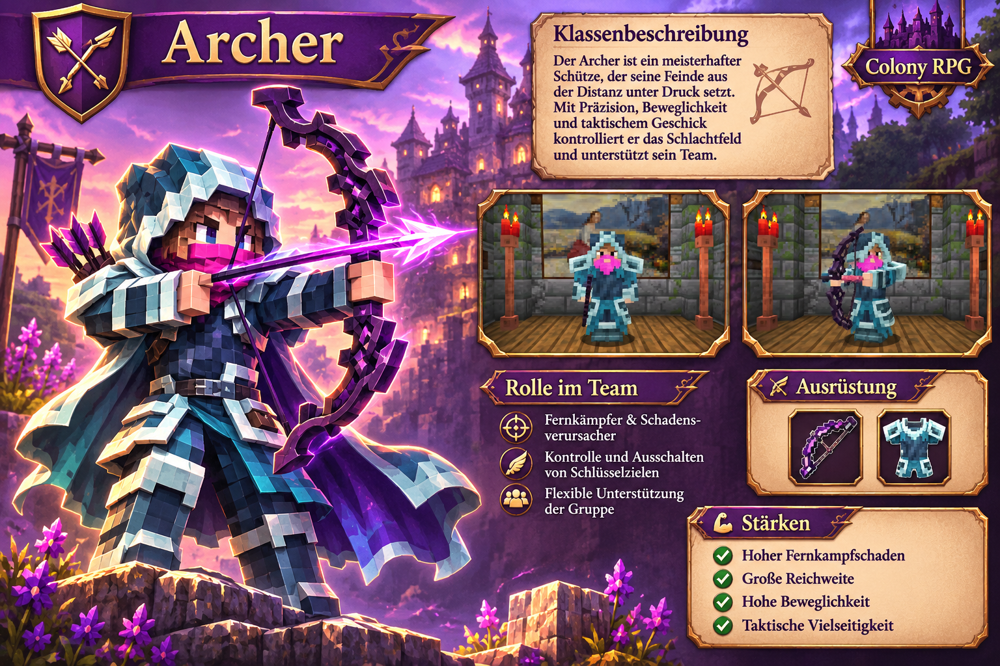
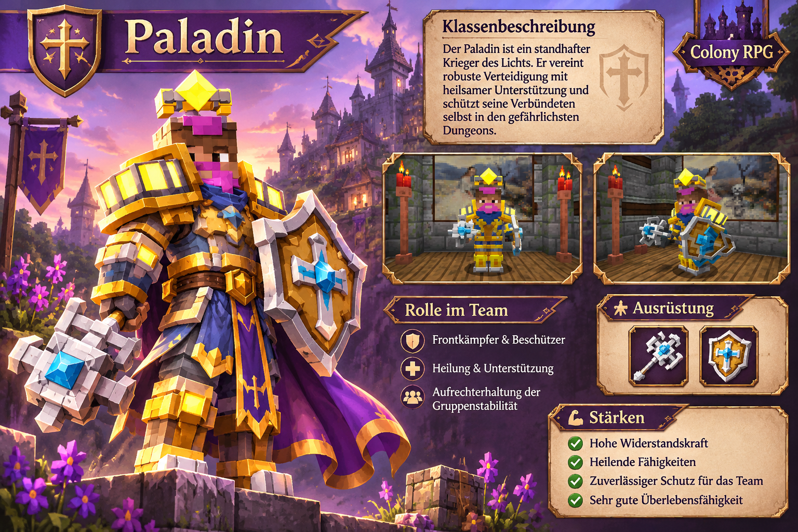
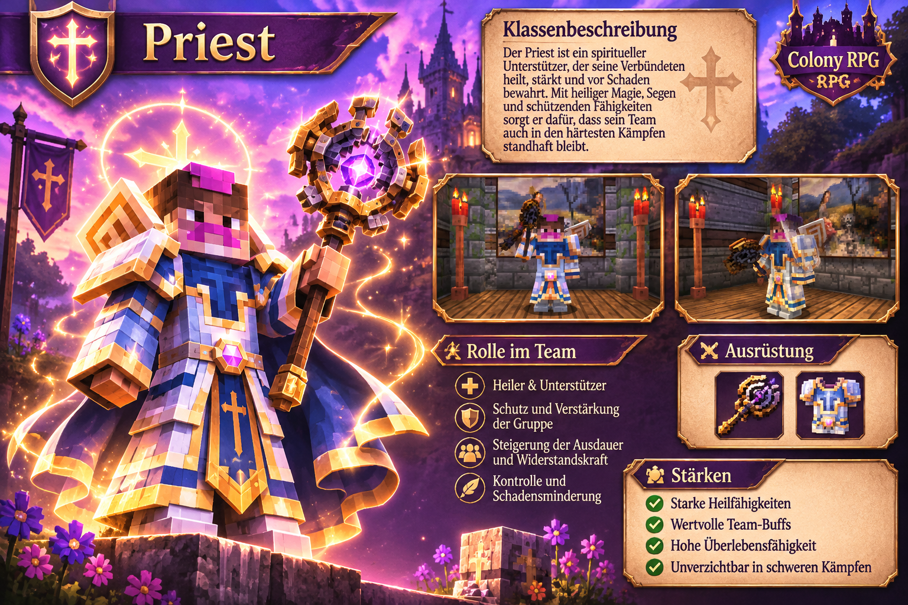
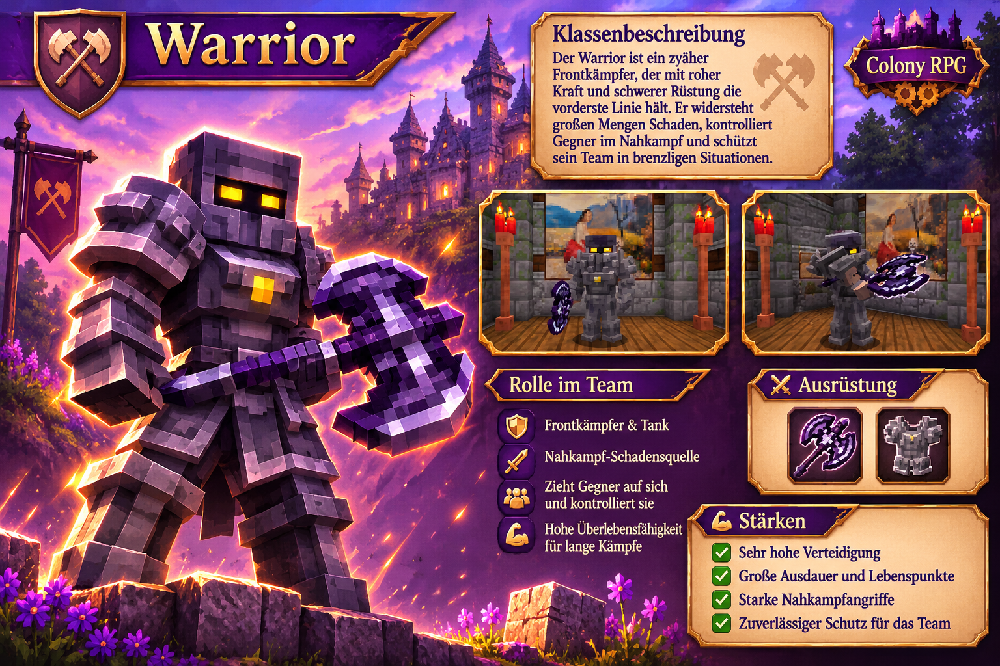
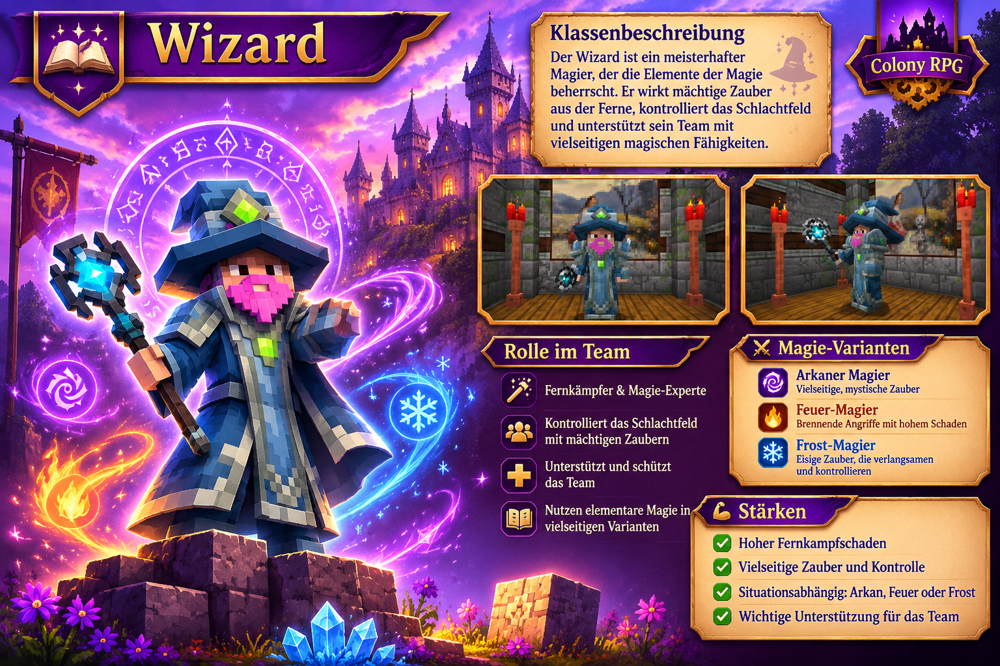
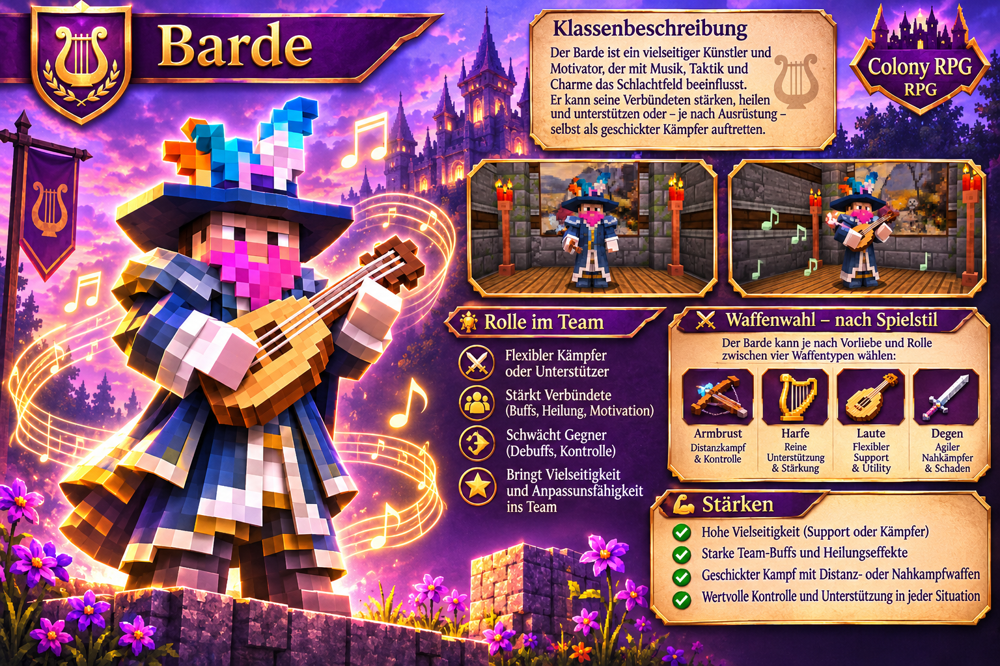

# RPG-System: Klassen und Ausrüstung

Das RPG-System erweitert Colony RPG um verschiedene Klassen und passende Ausrüstung. Du kannst aus acht Klassen wählen und deinen Charakter so gestalten, dass er zu deiner bevorzugten Spielweise passt.

## Die acht Klassen

Auf dem Server stehen folgende Klassen zur Auswahl:

  <figure class="crpg-class-card">
    
    <figcaption><strong>Archer</strong></figcaption>
  </figure>
  <figure class="crpg-class-card">
    
    <figcaption><strong>Paladin</strong></figcaption>
  </figure>
  <figure class="crpg-class-card">
    
    <figcaption><strong>Priest</strong></figcaption>
  </figure>
  <figure class="crpg-class-card">
    
    <figcaption><strong>Rogue</strong></figcaption>
  </figure>
  <figure class="crpg-class-card">
    
    <figcaption><strong>Warrior</strong></figcaption>
  </figure>
  <figure class="crpg-class-card">
    
    <figcaption><strong>Wizard</strong></figcaption>
  </figure>
  <figure class="crpg-class-card">
    
    <figcaption><strong>Berserker</strong></figcaption>
  </figure>
  <figure class="crpg-class-card">
    
    <figcaption><strong>Bard</strong></figcaption>
  </figure>

Die Bilder zeigen die jeweiligen Klassencharaktere in ihrer Ausrüstung. Die genaue Auswahl an Waffen, Rüstungen und weiteren Gegenständen wird in den zugehörigen Abschnitten dieses Wikis behandelt.

## Der Barde: Waffen nach Spielstil

Beim **Barden** kannst du zwischen mehreren Waffen wählen. Welche davon am besten passt, hängt davon ab, ob du lieber offensiv kämpfst oder deine Gruppe unterstützt.

- **Armbrust:** eine Wahl für einen stärker kämpferisch ausgerichteten Spielstil.
- **Degen:** ebenfalls eine kämpferische Waffenwahl.
- **Harfe:** eine Wahl für einen stärker unterstützenden Spielstil.
- **Laute:** ebenfalls für einen Support-orientierten Spielstil.

So kannst du den Barden passend zu deiner persönlichen Vorliebe ausrichten.

## Waffen und Rüstungen

Zum RPG-System gehören klassenspezifische Waffen und Rüstungen. Im Laufe des Spiels kannst du unterschiedliche Ausrüstungsgegenstände entdecken und deinen Charakter damit weiterentwickeln.

Welche Gegenstände verfügbar sind und wie sie sich unterscheiden, wird in den jeweiligen Ausrüstungs- und Klassenartikeln genauer beschrieben. Konkrete Werte, Rezepte oder Fundorte werden nur aufgenommen, wenn sie für die aktuelle Serverversion geprüft wurden.

## Runen und weitere Systeme

Runen und Magie werden in einem eigenen Kapitel behandelt: [Runen, Zauber und Magie](../systeme/11-runen-zauber-magie.md).

**Wichtig:** Runesmith ist eine eigenständige Mod und gehört nicht zur RPG-Serie. Die Runen, die für Ausrüstung aus der RPG-Serie benötigt werden, sind davon zu unterscheiden. Die beiden Systeme werden im Wiki getrennt erklärt.

## Weiterführende Kapitel

- [Runen, Zauber und Magie](../systeme/11-runen-zauber-magie.md)
- [Relikte, Schmuck und besondere Ausrüstung](../systeme/16-relikte-schmuck-ausruestung.md)
- [Dungeons und Dimensionen](../abenteuer/08-dungeons-und-dimensionen.md)

---

<small>Stand: Minecraft 1.21.1 · NeoForge. Die Klassenbilder zeigen den derzeitigen Stand der Charakterdarstellung. Servereigene Werte und Details werden vor Veröffentlichung anhand der installierten Mods und bestätigter Tests geprüft.</small>
