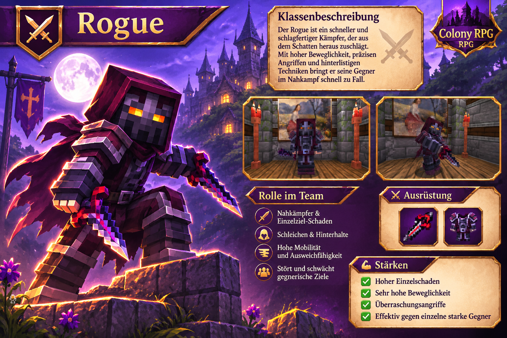
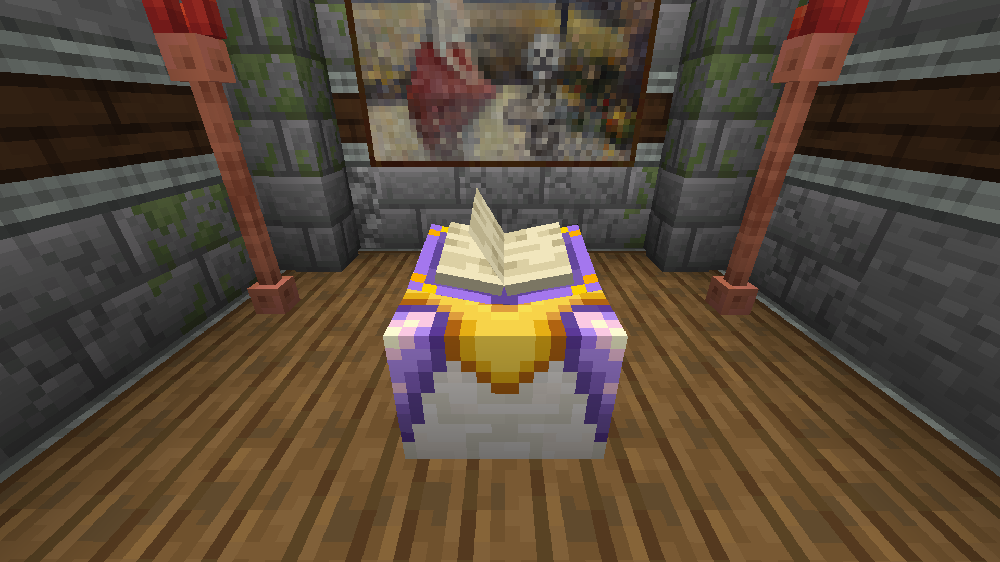
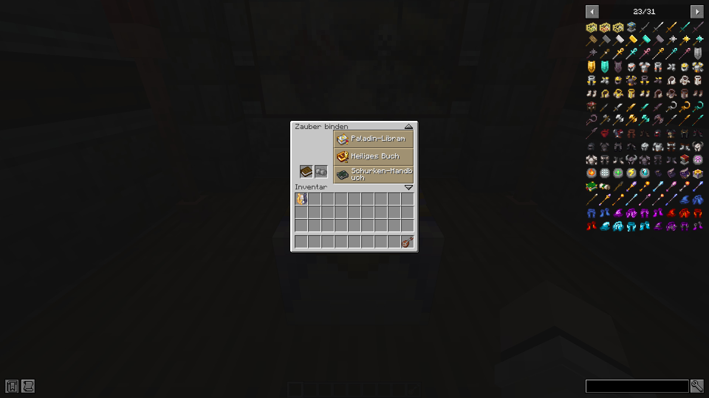

# RPG-System: Klassen und Ausrüstung

Das RPG-System erweitert Colony RPG um acht spielbare Klassen. Jede Klasse bringt einen eigenen Stil und passende Waffen sowie Rüstungen mit. So kannst du entscheiden, ob du lieber aus der Entfernung angreifst, dich direkt ins Getümmel stürzt, Magie einsetzt oder deine Gruppe unterstützt.

## Die acht Klassen im Überblick

  <figure class="crpg-class-card">
    
    <figcaption><strong>Archer</strong></figcaption>
  </figure>
  <figure class="crpg-class-card">
    
    <figcaption><strong>Paladin</strong></figcaption>
  </figure>
  <figure class="crpg-class-card">
    
    <figcaption><strong>Priest</strong></figcaption>
  </figure>
  <figure class="crpg-class-card">
    
    <figcaption><strong>Rogue</strong></figcaption>
  </figure>
  <figure class="crpg-class-card">
    
    <figcaption><strong>Warrior</strong></figcaption>
  </figure>
  <figure class="crpg-class-card">
    
    <figcaption><strong>Wizard</strong></figcaption>
  </figure>
  <figure class="crpg-class-card">
    
    <figcaption><strong>Berserker</strong></figcaption>
  </figure>
  <figure class="crpg-class-card">
    
    <figcaption><strong>Bard</strong></figcaption>
  </figure>

## Die Klassen und ihre Ausrichtung

### Archer – der Fernkämpfer

Der Archer ist auf Angriffe aus der Distanz ausgelegt. Mit Bögen und Armbrüsten kann er Gegner auf Abstand halten und gezielt unter Beschuss nehmen. Seine Fähigkeiten ergänzen den Fernkampf um Kontrolle und Angriffe auf mehrere Ziele. Zur Ausrüstung gehört unter anderem die Ranger-Rüstung.

### Paladin – der beschützende Kämpfer

Der Paladin verbindet schwere Ausrüstung mit einer standhaften Kampfweise. Er kann mit schweren Waffen und einem Schild kämpfen. Zu den passenden Ausrüstungsstücken zählen der Kite Shield und die Crusader-Rüstung. Damit eignet sich diese Klasse besonders für Spieler, die gerne gut geschützt in vorderster Reihe stehen.

### Priest – Magie und Unterstützung

Der Priest setzt auf eine magisch und unterstützend geprägte Ausrichtung. Statt schwerer Nahkampfwaffen stehen Stäbe und Zauberutensilien im Mittelpunkt. Zu seiner Ausrüstung gehören unter anderem Holy Staff, Zauberstäbe und passende Roben.

### Rogue – flink und beweglich

Der Rogue setzt auf leichte Ausrüstung und schnelle Waffen. Dolche und Sicheln gehören zu seinen typischen Waffen. Mit seiner leichten Rüstung ist er eine passende Wahl für Spieler, die einen beweglichen und direkten Kampfstil bevorzugen.

### Warrior – der schwer bewaffnete Nahkämpfer

Der Warrior ist auf den direkten Nahkampf ausgerichtet. Er nutzt schwere Rüstungen und wuchtige Waffen. Zu seinen Waffen gehören unter anderem Doppelaxt und Glaive. Diese Klasse passt zu Spielern, die den Kampf lieber aus nächster Nähe führen.

### Wizard – die arkane Magie

Der Wizard ist die Magieklasse mit drei Spezialisierungen: **Arkan**, **Feuer** und **Frost**. Arkane Magie konzentriert sich auf gezielte magische Angriffe, Feuer eignet sich besonders für Flächenschaden und Frost verbindet Schaden mit Verlangsamung und Kontrolle. Jede Spezialisierung besitzt eigene Zauberbücher und passende Stäbe sowie Roben.

### Berserker – der wilde Angreifer

Der Berserker ist auf hohen körperlichen Nahkampfschaden ausgelegt. Seine Stärke nimmt zu, wenn seine Lebenspunkte niedrig sind. Wut und erhöhte Angriffsgeschwindigkeit unterstützen seinen aggressiven Kampfstil; außerdem verfügt er über Möglichkeiten zur Selbstheilung und zum Aufbau zusätzlicher Absorption.

Äxte und leichtere Rüstungen passen zu seiner Ausrichtung. Seine offensive Spielweise bringt aber auch ein Risiko mit sich: Angriffe aus der Entfernung können für ihn besonders gefährlich werden. Zu seiner Ausrüstungsentwicklung gehören unter anderem die Bezeichnungen **Wildling**, **Northling** und **Norse Warlord**.

### Bard – vielseitig zwischen Kampf und Unterstützung

Der Bard verbindet musikalische Magie mit Kampf und Gruppenunterstützung. Sein Zauberbuch **Bard's Stories** enthält Lieder und Zauber, die Verbündete stärken, schützen oder heilen und auch Gegner beeinträchtigen können. Bei der Waffenwahl hast du besonders viel Freiheit. Du kannst entscheiden, ob du lieber selbst kämpfst oder deine Gruppe unterstützt.

- **Armbrust:** für einen stärker kämpferisch ausgerichteten Spielstil.
- **Degen:** für den direkten Kampf.
- **Harfe:** für einen unterstützenden Spielstil.
- **Laute:** ebenfalls für die Unterstützung deiner Gruppe.

Auch die Ausrüstungsentwicklung des Barden besitzt eigene Stufen: **Entertainer**, **Troubadour** und **The Storyteller**.

## Klassenfähigkeiten im Detail

Jede Klasse besitzt eigene aktive Fähigkeiten. Dazu gehören Angriffe, Bewegungs- und Kontrollfähigkeiten sowie Heil- und Unterstützungseffekte. Welche Fähigkeiten zu deiner Klasse gehören und wie sie eingesetzt werden, erklären die jeweiligen Klassenseiten:

- [Archer – Fernkampffähigkeiten](../rpg/klassen/archer.md)
- [Paladin – Schutz, Heilung und heilige Angriffe](../rpg/klassen/paladin.md)
- [Priest – Heilung und Unterstützung](../rpg/klassen/priest.md)
- [Rogue – Bewegung, Fallen und Überraschungsangriffe](../rpg/klassen/rogue.md)
- [Warrior – Nahkampf und Kontrolle](../rpg/klassen/warrior.md)
- [Wizard – arkane, Feuer- und Frostmagie](../rpg/klassen/wizard.md)
- [Berserker – Wut und offensive Fähigkeiten](../rpg/klassen/berserker.md)
- [Bard – Lieder und Gruppenunterstützung](../rpg/klassen/bard.md)

Die Klassen besitzen unterschiedliche aktive Fähigkeiten: Dazu gehören klassische Zauber, aber auch martialische Fertigkeiten und Lieder. Je nach Klasse werden sie über ein Klassenbuch, eine passende Waffe oder das zugehörige Fertigkeitssystem genutzt. Die genauen Fähigkeiten und ihre Verwendung findest du auf den verlinkten Klassenseiten sowie im Kapitel [Runen, Zauber und Magie](../systeme/11-runen-zauber-magie.md).

## Klassenbücher und neue Zauber lernen

Für jede Klasse gibt es ein eigenes **Klassenbuch**. Du erhältst es am **Zauberbindetisch**. Den Zauberbindetisch kannst du auch als vorgefertigte Struktur in einem natürlich generierten Dorf finden – du musst ihn also nicht unbedingt selbst aufstellen oder suchen und herstellen.

*Der Zauberbindetisch ist der Ort, an dem du dein Klassenbuch auswählst.*

1. Setze ein **leeres Buch** in den Zauberbindetisch ein.
2. Öffne das Auswahlmenü des Tisches.
3. Wähle dort die gewünschte Klasse aus.
4. Der Tisch erstellt das passende Klassenbuch.

*Im Menü „Zauber binden“ kannst du das gewünschte Klassenbuch auswählen.*

Für den Wizard gibt es drei Bücher – je nachdem, welche Magieschule du spielen möchtest:

| Klasse | Klassenbuch |
|---|---|
| Archer | Bogenschützen-Handbuch |
| Paladin | Paladin-Libram |
| Priest | Heiliges Buch |
| Rogue | Schurken-Handbuch |
| Warrior | Kodex der Krieger |
| Wizard – Arkan | Buch der Arkanen Künste |
| Wizard – Feuer | Buch des Feuers |
| Wizard – Frost | Buch des Frostes |
| Berserker | Nordischer Runen Wälzer |
| Bard | Bard's Stories |

Das Klassenbuch ist nicht nur ein Gegenstand für deine Ausrüstung: Je nach Klasse dient es dazu, Fähigkeiten freizuschalten oder Zauber zu verwenden. Beim Wizard wählst du zusätzlich eine der drei Magieschulen. Wie das Lernen und Verwenden der Fähigkeiten funktioniert, erklären wir im Kapitel [Runen, Zauber und Magie](../systeme/11-runen-zauber-magie.md).

## Waffen und Rüstungen

Die Klassen unterscheiden sich nicht nur durch ihre Ausrichtung, sondern auch durch ihre Ausrüstung. Manche setzen auf schwere Rüstungen und große Waffen, andere auf leichte Kleidung, Fernkampfwaffen oder magische Stäbe.

Im Laufe deiner Abenteuer kannst du weitere klassenspezifische Ausrüstung entdecken. Achte bei der Wahl deiner Gegenstände darauf, welche Klasse du spielst und welchen Stil du bevorzugst.

## Ausrüstung weiterentwickeln

Zum RPG-System gehören unterschiedliche Ausrüstungsstufen und Verbesserungsmöglichkeiten. Neben den Waffen und Rüstungen deiner Klasse gibt es weitere besondere Gegenstände, die deinen Charakter ergänzen können. Relikte und Schmuck werden in einem eigenen Kapitel vorgestellt.

## Weiterführende Kapitel

- [Runen, Zauber und Magie](../systeme/11-runen-zauber-magie.md)
- [Relikte, Schmuck und besondere Ausrüstung](../systeme/16-relikte-schmuck-ausruestung.md)
- [Dungeons und Bosse](../abenteuer/05-dungeons-und-bosse.md)

---

<small>Dieses Kapitel beschreibt die Klassen und ihre grundlegende Ausrichtung auf Colony RPG. Einzelne Gegenstände und Ausrüstungsstufen können je nach Klasse unterschiedlich sein.</small>
