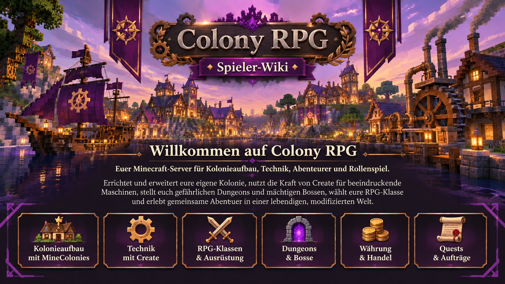

  

  
Das öffentliche Server-Wiki

  <h1>Willkommen auf Colony RPG</h1>
  
Eine Welt voller Kolonieaufbau, Technik, Rollenspiel und gemeinsamer Abenteuer.

# Eine neue Welt wartet auf dich

Du kommst in einer unbekannten Welt an. Vor dir liegen weite Landschaften, dichte Wälder, hohe Berge und Dörfer, in denen das Leben seinen eigenen Lauf nimmt. Vielleicht findest du einen ruhigen Ort für dein erstes Zuhause. Vielleicht zieht es dich aber auch hinaus, um die Welt zu erkunden und herauszufinden, welche Geheimnisse sie bereithält.

Auf **Colony RPG** entscheidest du selbst, welchen Weg du einschlägst. Du kannst mit **MineColonies** eine kleine Siedlung gründen und sie zu einer lebendigen Stadt ausbauen. Deine Bürger übernehmen Berufe, bauen Gebäude und kümmern sich um wichtige Aufgaben. Mit **Create** bringst du Bewegung in deine Welt: Zahnräder drehen sich, Maschinen arbeiten und technische Anlagen helfen dir dabei, Materialien zu verarbeiten und deine Kolonie zu versorgen.

Doch eine Stadt besteht nicht nur aus Mauern und Maschinen. Du brauchst Nahrung, Rohstoffe und Menschen, die deinen Ort mit Leben füllen. Auf deinen Reisen entdeckst du Dörfer, triffst Bewohner und findest neue Plätze, die du auf deiner Karte festhalten kannst. Mit **Waystones** kehrst du später bequem zu bereits entdeckten Orten zurück. Rucksäcke und weitere Ausrüstungs-Erweiterungen helfen dir, auch längere Expeditionen gut vorbereitet anzutreten.

Vielleicht zieht es dich irgendwann weiter fort – auf der Suche nach seltenen Schätzen, mächtigen Gegnern und vergessenen Bauwerken. Wähle eine von acht **RPG-Klassen**, entwickle deine Fähigkeiten und verbessere deine Ausrüstung. Runen, Zauber, Relikte und Schmuck eröffnen dir zusätzliche Möglichkeiten, deinen eigenen Kampfstil zu gestalten.

In den **Dimensional Dungeons** warten Fallen, Gegner und Beute auf dich. Mit **Lootr** kann jeder seine eigene Beute aus gemeinsamen Erkundungen erhalten. Und wenn ein Boss zu mächtig für einen einzelnen Abenteurer ist, kannst du dich mit anderen Spielern zusammentun. **Multiplayer Bosses** ergänzt das gemeinsame Erlebnis bei unterstützten Bosskämpfen. Die größten Herausforderungen und Expeditionen verlangen Vorbereitung, gute Ausrüstung und manchmal eine ganze Gruppe.

Deine Geschichte auf Colony RPG beginnt vielleicht mit einer einfachen Hütte. Was daraus wird, liegt bei dir: eine geschäftige Kolonie, eine technische Meisterleistung, eine Reise voller Entdeckungen oder eine Gemeinschaft, die sich gemeinsam den gefährlichsten Gegnern stellt.

## Dein Wegweiser durch die Welt

  <a class="crpg-card" href="grundlagen/01-willkommen/">
    📖
    <strong>Der Einstieg</strong>
    Die wichtigsten Informationen und Besonderheiten für deinen Start auf dem Server.
    <em>Zum Einstieg →</em>
  </a>
  <a class="crpg-card" href="grundlagen/03-minecolonies/">
    🏰
    <strong>Deine eigene Kolonie</strong>
    Gründe eine Siedlung, beschäftige Bürger und entwickle deine Stadt.
    <em>MineColonies entdecken →</em>
  </a>
  <a class="crpg-card" href="grundlagen/02-create/">
    ⚙️
    <strong>Technik und Maschinen</strong>
    Verbinde Zahnräder, baue Maschinen und automatisiere Abläufe mit Create.
    <em>Create entdecken →</em>
  </a>
  <a class="crpg-card" href="kolonie/18-die-welt-und-das-leben/">
    🌍
    <strong>Die Welt und das Leben</strong>
    Erkunde Landschaften, begegne Bewohnern, sichere deine Versorgung und reise zu neuen Orten.
    <em>Die Welt erkunden →</em>
  </a>
  <a class="crpg-card" href="grundlagen/04-rpg-system/">
    ⚔️
    <strong>Dein RPG-Abenteuer</strong>
    Finde deine Klasse, lerne Fähigkeiten und entwickle deinen Charakter.
    <em>Klassen kennenlernen →</em>
  </a>
  <a class="crpg-card" href="abenteuer/05-dungeons-und-bosse/">
    🏯
    <strong>Dungeons und Bosse</strong>
    Stelle dich gefährlichen Dungeons, Expeditionen und mächtigen Bossen.
    <em>Abenteuer beginnen →</em>
  </a>

## Weitere Entdeckungen

- [Wirtschaft, Münzen und Handel](systeme/06-wirtschaft-und-waehrung.md)
- [Runen, Zauber und Magie](systeme/11-runen-zauber-magie.md)
- [Waystones und Teleportation](systeme/13-waystones.md)
- [Quests und Aufträge](systeme/14-quests-und-auftraege.md)
- [Begleiter und Gefährten](abenteuer/15-begleiter.md)
- [Relikte, Schmuck und besondere Ausrüstung](systeme/16-relikte-schmuck-ausruestung.md)
- [Kreaturen und besondere Gegner](abenteuer/17-kreaturen-und-besondere-gegner.md)
- [Komfort- und Hilfsmods](systeme/22-komfort-und-hilfsmods.md)
- [Kommunikation und Mehrspieler](systeme/23-kommunikation-mehrspieler.md)

---

<small>Colony RPG basiert auf Minecraft 1.21.1 mit NeoForge. Dieses Wiki richtet sich an Spieler. Technische Konfigurationen, Loot-Tabellen, Admin-Befehle und interne Serververwaltung gehören in ein separates Admin-Handbuch.</small>
