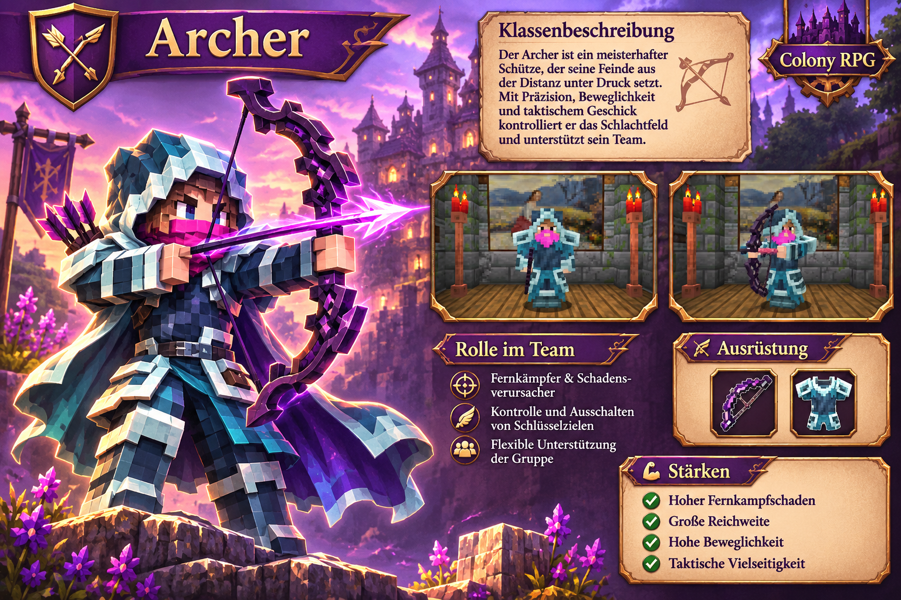

# Archer – der Fernkämpfer

Der Archer ist die auf Fernkampf und Bogenschießen ausgerichtete Klasse der RPG-Serie. Sein Schwerpunkt liegt darauf, Gegner aus sicherer Entfernung mit gezielten Schüssen unter Druck zu setzen. Die Klasse bietet damit eine andere Kampfweise als die auf Nahkampf spezialisierten Rollen.

## Spielstil

Der Archer eignet sich für Spieler, die den Abstand zum Gegner kontrollieren und ihre Angriffe aus der Distanz vorbereiten möchten. Positionierung und das richtige Timing beim Schießen sind wichtige Bestandteile dieses Spielstils.

## Fähigkeiten und Ausrüstung

Die Mod Archers ergänzt den Fernkampf um klassenbezogene Fertigkeiten und Ausrüstung. Die genauen Fertigkeiten sind im Spiel über das Archer-Zauberbuch und die zugehörigen Fertigkeitsschriftrollen zugänglich. Zur Mod gehören außerdem eigene Ausrüstungsgegenstände und Fernkampf-Inhalte.

Die Mod benötigt unter anderem AzureLib Armor, Ranged Weapon API und Spell Engine. Better Combat wird vom Mod-Autor für die passenden Waffenmechaniken empfohlen.

## Stärken und Grenzen

Der Schwerpunkt des Archers liegt auf dem Angriff aus der Entfernung. Wie bei jeder spezialisierten Klasse hängt der Erfolg davon ab, die eigene Kampfweise passend zur Situation einzusetzen. Konkrete Schadenswerte und Abklingzeiten werden hier bewusst nicht festgeschrieben, da sie von der Serverkonfiguration und den verwendeten Daten abhängen können.

## Quelle und Version

- [Archers (RPG Series) – CurseForge](https://www.curseforge.com/minecraft/mc-mods/archers)
- Installierte Serverdatei: Archers 3.1.3 für Minecraft 1.21.1 / NeoForge

[Zurück zur RPG-Übersicht](../../grundlagen/04-rpg-system.md)
