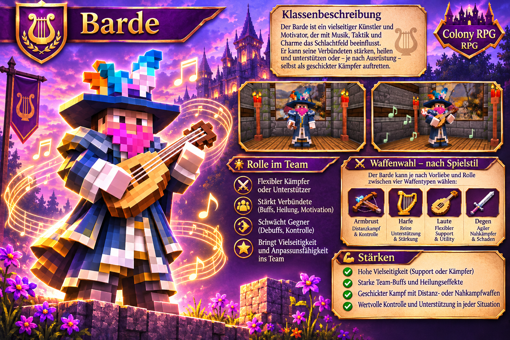

# Bard – Musik, Magie und vielseitige Unterstützung

Der Bard verbindet Angriffe mit musikalischer Magie und Unterstützung für Verbündete. Die Sprach- und Zauberdateien der installierten Mod zeigen, dass seine Lieder nicht nur Gegner treffen, sondern auch Verbündete heilen, stärken oder schützen können.

## Spielstil und Waffenwahl

Auf Colony RPG kannst du beim Barden zwischen vier Waffen wählen. Die Entscheidung hängt davon ab, ob du eher kämpfen oder deine Gruppe unterstützen möchtest:

- **Armbrust:** für einen stärker kämpferischen Fernkampfstil.
- **Degen:** für den direkten Kampf.
- **Harfe:** für einen stärker unterstützenden Musikstil.
- **Laute:** ebenfalls für einen unterstützenden Musikstil.

## Lieder und Unterstützungszauber

Die Mod enthält verschiedene Lieder und musikalische Zauber. Dazu gehören Effekte, die:

- Verbündete heilen und ihnen Absorption gewähren,
- die Bewegungsgeschwindigkeit von Verbündeten erhöhen,
- den erlittenen Schaden von Verbündeten verringern,
- offensive Werte und kritische Trefferchancen verbessern,
- Gegner schädigen oder ihre Angriffskraft schwächen,
- Abklingzeiten aktiver Zauber beeinflussen.

Einige Lieder kombinieren mehrere Wirkungen: Sie können Gegnern schaden und gleichzeitig Verbündete in der Nähe unterstützen.

## Spielweise in der Gruppe

Der Barde kann je nach Waffenwahl und eingesetzten Liedern unterschiedliche Aufgaben übernehmen. Er kann sich stärker auf eigene Angriffe konzentrieren oder die Gruppe mit Heilung, Schutz und Stärkung begleiten. Dadurch ist er eine flexible Klasse für gemeinsames Spielen.

## Quelle und Version

- [Bards RPG – CurseForge](https://www.curseforge.com/minecraft/mc-mods/bards-rpg)
- Installierte Serverdatei: Bards RPG 1.2.1 für Minecraft 1.21.1 / NeoForge

[Zurück zur RPG-Übersicht](../../grundlagen/04-rpg-system.md)
