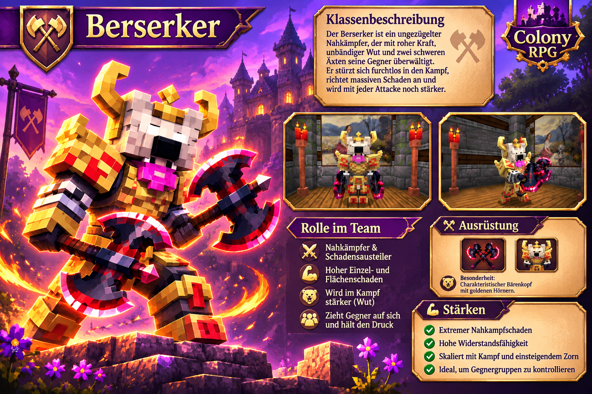

# Berserker – Wut und rohe Kraft

Der Berserker ist eine aggressive Nahkampfklasse. Seine Spielweise dreht sich um Wut, kraftvolle Angriffe und das Risiko, im Kampf selbst Schaden in Kauf zu nehmen. Die installierte Mod enthält Fähigkeiten, die physischen Schaden mit weiteren Schadensarten verbinden.

## Spielstil

Der Berserker ist auf den direkten Kampf ausgelegt. Seine Fähigkeiten können Gegner erschrecken, den Berserker vorübergehend stärken oder Schaden in zusätzliche Absorption umwandeln. Einige Fertigkeiten kosten den Berserker selbst Gesundheit oder nutzen seine Wut, um ihre Wirkung zu steigern.

Ein wichtiges Merkmal der Klasse ist der **Rage-Attributbonus**: Je weniger Lebenspunkte du hast, desto mehr Schaden kannst du verursachen. Das passt zum riskanten Spielstil des Berserkers. Gehe dabei trotzdem vorsichtig vor – wenig Leben macht dich zugleich verwundbarer.

## Fähigkeiten

Die deutsche Sprachdatei der installierten Mod beschreibt unter anderem:

- **Furchteinflößender Effekt:** Verängstigt Ziele und verleiht dem Berserker den Wuteffekt.
- **Schadensumwandlung:** Eine Fähigkeit verursacht physischen Schaden und gewährt Absorption in Höhe des verursachten Schadens. Bei sehr geringer Gesundheit können negative Effekte auftreten.
- **Wirbelnder Angriff:** Verursacht fortlaufend physischen und Frostschaden.
- **Wurf:** Wirft die Waffe, verursacht physischen Schaden und verlangsamt das Ziel.
- **Blitzsprung:** Ein schneller Sprung verursacht physischen und Blitzschaden.
- **Blitzschlag:** Beschwört einen Blitz, der Blitzschaden verursacht und Ziele entzündet.
- **Seelenentzug:** Verursacht dem Berserker selbst Schaden, entzieht Zielen Seelen und verursacht Seelenschaden.
- **Wilder Schlag:** Verursacht physischen Schaden, entfernt negative Effekte und kann bei maximaler Wut die Dauer des Wuteffekts erhöhen.
- **Absorption in Heilung umwandeln:** Eine weitere Fähigkeit wandelt Absorption in Leben um und verlängert die Wutdauer.

## Ausrüstung

Die Mod ergänzt eigene Berserker-Ausrüstung und passende Waffen. Die Klasse ist auf hohen physischen Nahkampfschaden ausgelegt. Einige Waffen können hergestellt werden, andere sind als Beute in Truhen zu finden.

Die Ausrüstung profitiert vom Attribut **Rage**: Mit sinkenden Lebenspunkten steigt der verursachte Schaden. Die Modbeschreibung weist außerdem darauf hin, dass Berserker-Ausrüstung als Beute häufiger für Spieler vorgesehen ist, die das passende Klassenbuch bei sich tragen.

## Fähigkeiten einsetzen

Für Berserker-Zauber kannst du ein Zauberbuch mit einem gebundenen Zauber-Pool ausrüsten oder Waffen verwenden, an die ein Zauber gebunden wurde. Das Berserker-Zauberbuch lässt sich am Zauberbindetisch herstellen. Die genauen Fähigkeiten und ihre Werte können von der installierten Modversion abhängen.

## Hinweis zur Spielweise

Der Berserker wird stärker, wenn seine Lebenspunkte sinken. Das bedeutet aber nicht, dass du dich absichtlich bis kurz vor den Tod bringen solltest. Nutze Absorption und Heilfähigkeiten bewusst und achte darauf, dass du den nächsten gegnerischen Treffer überstehen kannst.

## Quelle und Version

- [Berserker (RPG Series Plus) – CurseForge](https://www.curseforge.com/minecraft/mc-mods/berserker-rpg-class)
- Installierte Serverdatei: Berserker RPG 3.2.0 für Minecraft 1.21.1 / NeoForge

[Zurück zur RPG-Übersicht](../../grundlagen/04-rpg-system.md)

---