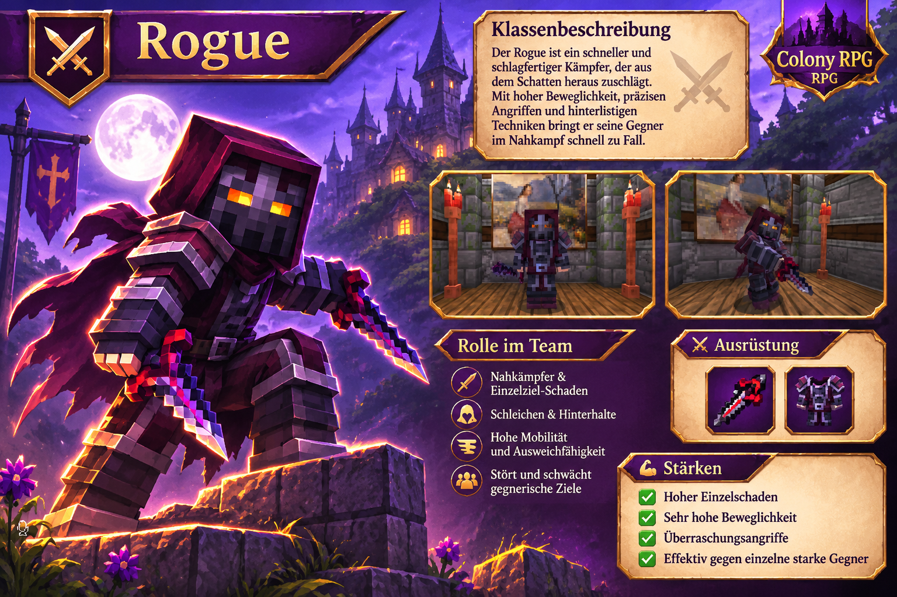

# Rogue – flink und tödlich

Der Rogue greift mit schnellen Waffen und besonderen Fertigkeiten aus dem Schatten an. Seine Klassenbeschreibung hebt hohe Beweglichkeit und starken Nahkampfschaden hervor. Dafür ist seine Verteidigung nur mittelmäßig und seine Auswahl an Fernkampfangriffen begrenzt.

## Spielstil

Der Rogue ist eine bewegliche Nahkampfklasse. Er setzt auf schnelle Angriffe, überraschende Positionswechsel und Fähigkeiten, mit denen er Gegner kurzzeitig kontrollieren oder sich selbst verbergen kann.

## Fähigkeiten

Die deutsche Beschreibung der installierten Mod führt unter anderem diese Fertigkeiten auf:

- **Schattenschritt:** Der Rogue bewegt sich durch die Schatten und erscheint hinter seinem Ziel.
- **Verschwinden:** Er kann sich für kurze Zeit tarnen. Eine eigene Handlung oder erlittener Schaden beendet den Effekt.
- **Verstümmeln:** Ein Angriff mit beiden gehaltenen Waffen, der den Schaden beider Waffen berücksichtigt.
- **Bärenfalle:** Drei Fallen werden um den Rogue herum platziert. Ein Gegner, der eine Falle auslöst, wird verletzt und festgehalten.
- **Schockpulver:** Betäubt Gegner in der Nähe.
- **Netzwurf:** Ein geworfenes Netz verursacht Schaden und hält das getroffene Ziel fest.
- **Zerschmetternder Wurf:** Eine geworfene Waffe verursacht Schaden und verringert zeitweise die Rüstung des Ziels.

## Waffen und Rüstung

Der Rogue ist mäßig gepanzert. Zu den Waffen gehören Dolche und Sicheln. Die Mod enthält außerdem eigene Rüstungsteile und Fertigkeitsschriftrollen.

Die Mod empfiehlt besonders schnelle Waffen, die du **in beiden Händen** führst – zum Beispiel Dolche oder Sicheln. Das passt zu den Fähigkeiten des Rogue, die auf schnelle Angriffe und Beweglichkeit ausgelegt sind.

## Fähigkeiten einsetzen

Das **Schurken-Handbuch** schaltet die Rogue-Fähigkeiten frei. Rüste das Zauberbuch aus und halte eine Waffe in der Hand, um die Fähigkeiten einzusetzen. Für den empfohlenen Spielstil eignen sich schnelle Waffen in beiden Händen besonders gut.

Wie du dein Klassenbuch erhältst, wird im Kapitel [RPG-Klassen und Ausrüstung](../../grundlagen/04-rpg-system.md) erklärt.

## Stärken und Grenzen

**Stärken:** Hohe Beweglichkeit und hoher Nahkampfschaden.

**Grenzen:** Mittelmäßige Verteidigung und begrenzte Fernkampfangriffe.

## Quelle und Version

- [Rogues & Warriors (RPG Series) – CurseForge](https://www.curseforge.com/minecraft/mc-mods/rogues-and-warriors)
- Installierte Serverdatei: Rogues 3.1.3 für Minecraft 1.21.1 / NeoForge

[Zurück zur RPG-Übersicht](../../grundlagen/04-rpg-system.md)

---