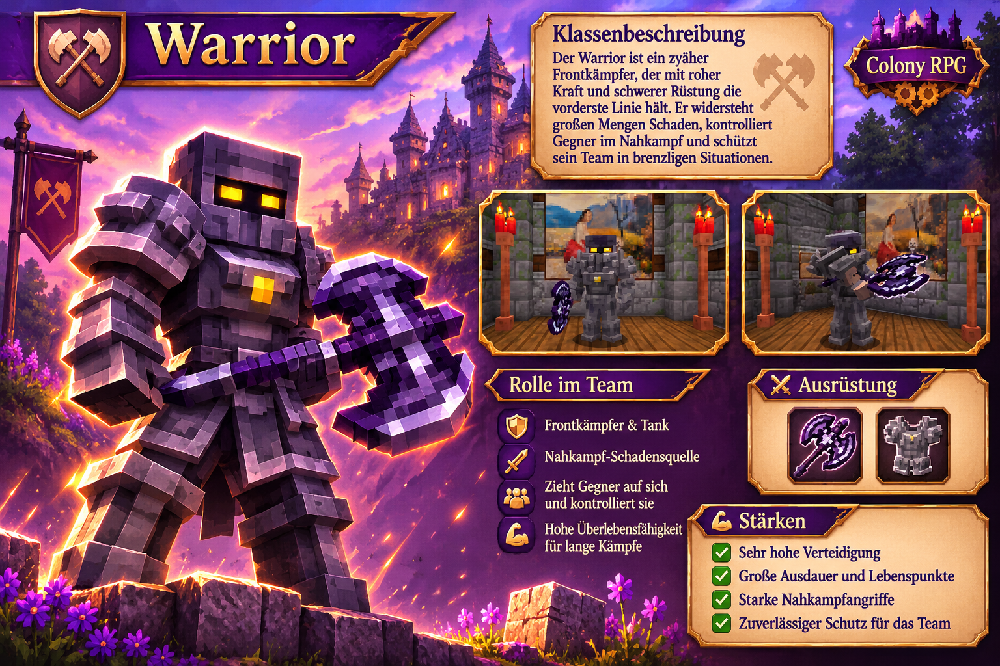

# Warrior – der schwer gepanzerte Nahkämpfer

Der Warrior dominiert den Nahkampf mit schweren Waffen und kämpferischen Fertigkeiten. Seine Klassenbeschreibung nennt starke Nahkampfangriffe und gute Beweglichkeit als Stärken. Seine Möglichkeiten auf Distanz und bei der Unterstützung anderer Spieler sind dagegen begrenzt.

## Spielstil

Der Warrior ist für Spieler gedacht, die den direkten Kampf suchen. Er trägt schwere Rüstung und setzt auf kraftvolle Waffen. Seine Fertigkeiten verbinden offensive Angriffe mit Möglichkeiten, Gegner zu kontrollieren und die eigene Widerstandsfähigkeit zu erhöhen.

## Fähigkeiten

Die installierte Mod enthält unter anderem:

- **Ansturm:** Erhöht Bewegungsgeschwindigkeit und Rückstoßresistenz.
- **Letztes Gefecht:** Während des Kanalisierens steigen maximale Gesundheit und Rückstoßresistenz mit jedem Stapel.
- **Vernichtender Schlag:** Ein Überkopfschlag verursacht zusätzlichen Waffenschaden und lässt das Ziel bluten.
- **Demoralisierender Schrei:** Verringert den Angriffsschaden naher Gegner.
- **Schnitt & Stich:** Ein Kampfrausch, bei dem Angriffe zusätzliche Kraft aufbauen.
- **Zerschmetternder Wurf:** Eine geworfene Waffe verursacht Schaden und verringert die Rüstung des Ziels.
- **Netzwurf:** Hält ein getroffenes Ziel fest.

## Waffen und Rüstung

Der Warrior ist schwer gepanzert. Die Mod enthält eine eigene Krieger-Rüstung sowie schwere Waffen wie Doppelaxt und Glefe. Weitere Waffenvarianten sind abhängig von den verfügbaren Materialien.

Die offizielle Modbeschreibung empfiehlt langsame, schwere Waffen wie **Doppeläxte, Glefen und Claymores**. Diese Waffen passen zum kraftvollen Kampfstil des Warrior.

## Fähigkeiten einsetzen

Der **Krieger-Kodex** schaltet die Warrior-Fähigkeiten frei. Rüste das Zauberbuch aus und halte eine Waffe in der Hand, um die Fähigkeiten zu verwenden. Für den empfohlenen Spielstil sind schwere, langsamere Waffen eine gute Wahl.

Wie du dein Klassenbuch erhältst, wird im Kapitel [RPG-Klassen und Ausrüstung](../../grundlagen/04-rpg-system.md) erklärt.

## Stärken und Grenzen

**Stärken:** Starke Nahkampfangriffe und gute Beweglichkeit.

**Grenzen:** Begrenzte Fernkampfangriffe und wenige unterstützende Fertigkeiten.

## Quelle und Version

- [Rogues & Warriors (RPG Series) – CurseForge](https://www.curseforge.com/minecraft/mc-mods/rogues-and-warriors)
- Installierte Serverdatei: Rogues 3.1.3 für Minecraft 1.21.1 / NeoForge

[Zurück zur RPG-Übersicht](../../grundlagen/04-rpg-system.md)

---