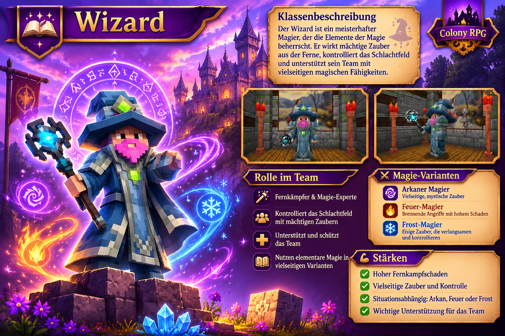

# Wizard – die Macht der Magie

Der Wizard nutzt Zauberbücher und magische Stäbe. Die Klasse teilt sich in drei Spezialisierungen auf: **Arkan**, **Feuer** und **Frost**. Jede Richtung besitzt einen eigenen Schwerpunkt und eigene Zauber.

## Arkaner Magier

Arkane Zauber konzentrieren sich auf starken magischen Schaden gegen einzelne Ziele. Zu den Fähigkeiten gehören arkane Geschosse, Explosionen und Strahlen. Mit Arkanem Blinzeln kann sich der Wizard außerdem nach vorne teleportieren.

**Stärke:** konzentrierter Schaden gegen einzelne Gegner.

**Grenze:** sehr geringe Verteidigung.

## Feuer-Magier

Feuermagie eignet sich für Angriffe auf mehrere Gegner und größere Bereiche. Zu den Zaubern gehören Feuerball, Feuerexplosion, Feueratem, Meteor und Flammenwand. Weitere Fähigkeiten beschwören Feuerhydra-Köpfe oder erzeugen großflächige Feuerangriffe.

**Stärke:** magischer Schaden in großen Bereichen.

**Grenzen:** geringe Verteidigung und Mobilität.

## Frost-Magier

Frostmagie verlangsamt Gegner und kann sie einfrieren. Frostblitz, Frostnova, Froststacheln und Eislanze gehören zu den Zaubern. Der Frostschild schützt vor Angriffen, Geschossen und Feuer, verlangsamt währenddessen aber die eigene Bewegung. Ein Frostelementar kann den Wizard im Kampf unterstützen.

**Stärke:** magischer Schaden und Kontrolle über die Bewegung der Gegner.

**Grenzen:** geringe Verteidigung und Mobilität.

## Zauberbücher, Stäbe und Roben

Jede Spezialisierung besitzt ein eigenes Zauberbuch, passende Zauberrollen, Stäbe und Roben. Die Ausrüstung ist auf die jeweilige Magieart abgestimmt. Es gibt außerdem weiterentwickelte Varianten der Stäbe und Roben.

Die Modbeschreibung empfiehlt, einen **Zauberstab oder Stab** zu verwenden. Diese Waffen besitzen bereits einen Grundzauber. Die drei Zauberbücher ergänzen den Wizard um weitere Fähigkeiten:

- **Buch der Arkanen Künste:** konzentrierte arkane Zauber gegen einzelne oder eng zusammenstehende Gegner.
- **Buch des Feuers:** offensive Feuerzauber für größere Bereiche.
- **Buch des Frostes:** Frostzauber, die Gegner schädigen, ihre Bewegung einschränken und den Wizard schützen können.

## Zauber einsetzen und verbessern

Rüste das passende Zauberbuch aus und halte einen Stab oder Zauberstab in der Hand, um die Zauber deiner Spezialisierung einzusetzen. Für gewirkte Zauber werden passende Runen benötigt.

Auch Verzauberungen können deinen Magiestil ergänzen. Die Mod nennt unter anderem:

- **Spell Power:** Erhöht allgemein den Zauberschaden.
- **Spell Haste:** Erhöht die Zaubergeschwindigkeit.
- **Spell Infinity:** Ermöglicht das Wirken von Zaubern ohne Runenkosten.

Ob und wie häufig du diese Verzauberungen findest, hängt von den verfügbaren Spielinhalten und der Serverkonfiguration ab. Weitere Informationen zu Runen findest du im Kapitel [Runen, Zauber und Magie](../../systeme/11-runen-zauber-magie.md).

## Quelle und Version

- [Wizards (RPG Series) – CurseForge](https://www.curseforge.com/minecraft/mc-mods/wizards)
- Installierte Serverdatei: Wizards 3.1.3 für Minecraft 1.21.1 / NeoForge

[Zurück zur RPG-Übersicht](../../grundlagen/04-rpg-system.md)

---