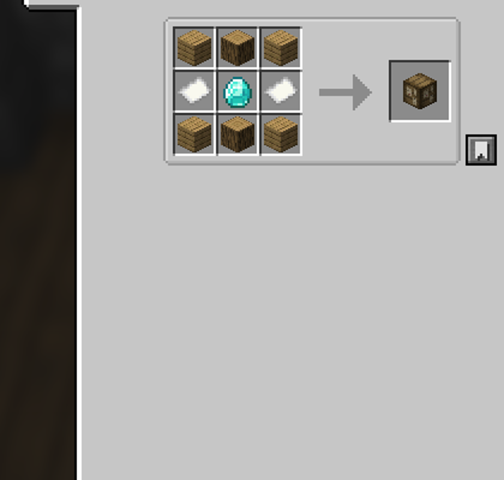

# Quests und Aufträge

Manchmal ist das Abenteuer gerade vorbei, die nächste Expedition noch nicht geplant und in der eigenen Kolonie gibt es für den Moment nichts zu erledigen. Genau dann lohnt sich ein Blick auf das Auftragsbrett: Vielleicht wartet im nächsten Dorf schon ein Auftrag auf dich.

Ob du Materialien für andere Bewohner beschaffst, dich auf Monsterjagd begibst oder dich irgendwann sogar einem mächtigen Boss stellst – auf Colony RPG findest du zusätzliche Ziele und kannst dir für deine Mühen besondere Belohnungen verdienen.

## Das Auftragsbrett finden

Das Auftragsbrett stammt aus der Mod **Bountiful**. Du findest es als natürlich generierte Struktur in Minecraft-Dörfern. Halte bei deinen Reisen durch die Welt also Ausschau nach einem kleinen Gebäude mit einem Auftragsbrett.

Wenn du das Brett mit einem Rechtsklick öffnest, siehst du die aktuell verfügbaren Aufträge. Jeder Auftrag zeigt dir, was erledigt werden muss und welche Belohnung dafür vorgesehen ist.

### Ein eigenes Auftragsbrett herstellen

Du musst nicht erst ein Dorf finden, um Aufträge anzunehmen. Du kannst das Auftragsbrett auch selbst herstellen. Dafür benötigst du:

- 4 Holzbretter
- 2 Holzstämme
- 2 Papier
- 1 Diamant

Lege die Zutaten wie im Rezeptbild gezeigt in den Werktisch:

## Dekrete bestimmen die Aufträge

Ein **Dekret** legt fest, welche Arten von Aufträgen auf einem Auftragsbrett erscheinen können. Die normalen Dekrete von Bountiful decken verschiedene Themen ab. Das Brett in einem generierten Dorf enthält zufällig eines dieser Standard-Dekrete.

Zusätzlich gibt es auf Colony RPG ein eigenes Dekret: **Colony RPG**. Es erweitert das Auftragssystem um speziell für unseren Server erstellte Aufgaben. Dieses Dekret kann als Belohnung in Aufträgen auftauchen. Wenn du es erhältst, kannst du damit die besonderen Colony-RPG-Aufträge freischalten.

Ein Auftragsbrett kann mehrere Dekrete aufnehmen. Dadurch können sich unterschiedliche Auftragsthemen ergänzen und miteinander vermischen.

## Aufträge auf Colony RPG

Das eigene Dekret bringt verschiedene Aufgaben mit, die dich durch die Welt und die Inhalte des Servers führen.

### Kolonie und Abenteuer

Bei diesen Aufträgen beschaffst du Baumaterialien und andere Gegenstände. Dazu gehören beispielsweise:

- 32 bis 64 Fichtenstämme
- 32 bis 64 Steinziegel
- 8 bis 16 Laternen
- 4 bis 8 Bücher
- seltene Ancient Tomes aus MineColonies

Diese Aufgaben eignen sich, wenn du gerade sammelst, baust oder deine Vorräte auffüllen möchtest.

### Monsterjagd

Nicht jeder Auftrag verlangt nach Materialien. Einige schicken dich direkt in den Kampf. Du kannst zum Beispiel aufgefordert werden, Zombies oder Spinnen zu besiegen. Anspruchsvollere Jagdaufträge können auch Creeper zum Ziel haben.

### Elite-Gegner und Bosse

Für erfahrene Abenteurer gibt es besonders gefährliche Ziele. Dazu gehören unter anderem:

- **Epic:** Warden und Elder Guardian
- **Epic:** Enderdrache und Wither
- **Legendary:** Ender Guardian, Netherite Monstrosity, Ignis, The Harbinger, The Leviathan, Ancient Remnant, Maledictus, Aptrgangr und Wadjet

Die Cataclysm-Bosse gehören damit zu den besonders anspruchsvollen Aufträgen. Für diese Kämpfe solltest du gut vorbereitet sein und deine Ausrüstung entsprechend wählen. **Scylla ist nicht Teil des Colony-RPG-Auftragspakets.**

Boss- und Elite-Aufträge haben auf Colony RPG kein Zeitlimit. Du kannst dir also die Zeit nehmen, deine Ausrüstung vorzubereiten und Mitstreiter für den Kampf zu finden.

## Seltenheit und Belohnungen

Aufträge besitzen unterschiedliche Seltenheitsstufen. Je höher die Stufe, desto außergewöhnlicher können die Aufgabe und die Belohnung ausfallen.

| Seltenheit | Typische Belohnungen |
|---|---|
| Common | Kupfermünzen |
| Uncommon | Eisenmünzen und passende Sachbelohnungen |
| Rare | Eisenmünzen und besondere Gegenstände |
| Epic | Bis zu 2 Messingmünzen sowie wertvolle Gegenstände |
| Legendary | Goldmünzen und seltene Bossmaterialien |

Neben Münzen können besondere Ausrüstungsgegenstände, Relikte und Materialien aus den RPG- und Cataclysm-Mods als Belohnung auftauchen. Dazu gehören beispielsweise ausgewählte Klassenwaffen, Relikte sowie seltene Materialien wie Witherite-, Ignitium- oder Cursium-Barren.

Zink- und Netheritmünzen sind nicht als Questbelohnungen vorgesehen. Die Münzbelohnungen sind bewusst begrenzt, damit Aufträge eine zusätzliche Einnahmequelle bleiben und nicht zum einfachen Weg werden, große Mengen Geld zu farmen.

## Einen Auftrag annehmen und abschließen

1. Öffne das Auftragsbrett mit einem Rechtsklick.
2. Suche dir einen Auftrag aus, der zu deiner Ausrüstung und deinem Vorhaben passt.
3. Nimm den Auftrag vom Brett. Er wird als Gegenstand in deinem Inventar abgelegt.
4. Erfülle die angezeigten Ziele. Bei Jagdaufträgen solltest du den Auftrag während der Jagd im Inventar behalten, damit dein Fortschritt erfasst werden kann.
5. Kehre mit dem abgeschlossenen Auftrag zum Auftragsbrett zurück und gib ihn dort ab, um deine Belohnung zu erhalten.

Lies dir vor dem Aufbruch immer die Anforderungen und die Belohnung durch. So weißt du, ob du nur ein paar Materialien sammeln musst oder ob dich ein gefährlicher Gegner erwartet.

## Gemeinsam auf große Jagd

Nicht jeder Auftrag muss allein erledigt werden. Gerade bei den mächtigen Bossen lohnt es sich, Freunde oder andere Spieler zu fragen, ob sie dich begleiten. Bereitet eure Ausrüstung vor, besprecht eure Rollen und macht euch gemeinsam auf den Weg.

Vielleicht ist der Auftrag am Brett nur ein kleiner Zettel – aber daraus kann das nächste große Abenteuer auf Colony RPG werden.
